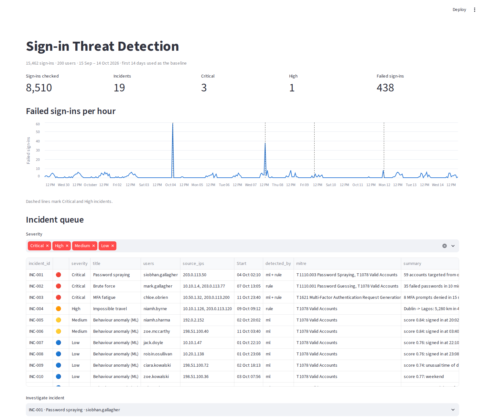

# Login Anomaly Detection

Detects account compromise in sign-in logs by combining **detection rules** for known attack patterns with an **unsupervised machine learning model** that learns each person's normal behaviour. Alerts are grouped into incidents with MITRE ATT&CK mapping, plain-English reasons and a response playbook, the way a SOC analyst would work them.



## The problem

Most breaches don't start with malware. They start with a stolen password and a sign-in that looks legitimate. Rules catch the noisy attacks (hundreds of failed passwords), but a careful attacker or an insider using their own laptop at 3am trips no rule at all. Pure anomaly detection has the opposite problem: it flags every business trip and late night.

This project tests both approaches on the same data, measures what each catches and what each costs in false alarms, and combines them.

## How it works

```
Sign-in logs ─► behaviour features ─┬─► 6 detection rules ──────────────┐
                (per user, using    │                                   ├─► incidents ─► triage dashboard
                 only past events)  └─► Isolation Forest (unsupervised) ─┘     (severity, MITRE, reasons, playbook)
```

**Detection rules**

| Rule | Catches | MITRE ATT&CK |
|---|---|---|
| Brute force | 10+ failed passwords for one account from one IP in 10 min (Critical if followed by a success) | T1110.001 |
| Password spraying | One IP failing against 10+ different accounts in 30 min (Critical if any account signs in) | T1110.003 |
| Impossible travel | Two sign-ins further apart than a plane could travel (over 900 km/h, 500+ km) | T1078 |
| MFA fatigue | 5+ MFA prompts denied in 15 min, then approved | T1621 |
| New country + new device | First sign-in from both a new country and a new device | T1078 |
| Night sign-in, new device | 00:00–05:00 sign-in from a device the person has never used | T1078 |

**Behaviour model.** An Isolation Forest scores every successful sign-in on 10 features. Each one is computed only from earlier events, as a live system would see them:

- time-of-day rarity *for that person*
- weekend
- new device, new country, new app
- distance from the person's usual location
- travel speed since their last sign-in
- recent failed passwords for the account
- other accounts failing from the same IP
- recent MFA denials

The model uses **no labels**. The first 14 days are the baseline, and the alert threshold is set so that only 0.1% of baseline sign-ins would have alerted. Every ML alert says *why* it fired, for example: "signed in at 03:40, usually 08:02–17:49; weekend; first use of VPN".

## Test data

`generate_logs.py` creates 30 days of sign-ins for a made-up 200-person company: 15,462 events across Microsoft 365, VPN, Salesforce, Workday, ServiceNow, SAP and AWS. It includes:

- **Normal behaviour:** office and home sign-ins, typos, weekend workers.
- **Benign oddities that *shouldn't* alert:** four business trips (London, Paris, New York, Bengaluru), a new phone, two people working late.
- **Six labelled attacks:**

| Scenario | What happens |
|---|---|
| A1 Password spray | One IP tries one password against 60 accounts in 25 minutes at 2am; one account falls, and the attacker reads the mailbox |
| A2 Brute force | 35 failed passwords in 8 minutes, then success |
| A3 Impossible travel | Normal sign-in from Ireland, then Lagos 45 minutes later, opening the AWS console |
| A4 MFA fatigue | Correct password, 8 push prompts denied, then approved just before midnight |
| A5 Insider misuse | Own laptop, home IP, but 3:40am on a Sunday and an app the person has never used (SAP) |
| A6 Low-and-slow spray | 15 accounts over 3 days, 5 a day, hours apart, designed to stay under rule thresholds |

All IP addresses are from reserved documentation ranges (RFC 5737) or private ranges.

## Results

| Method | Attacks detected | False-positive events | False positives per day |
|---|---|---|---|
| Rules only | 4 / 6 | 4 | 0.2 |
| ML only | 3 / 6 | 14 | 0.9 |
| **Rules + ML** | **5 / 6** | 18 | 1.1 |

| Attack | Rules | ML | Combined |
|---|---|---|---|
| A1 Password spray | ✅ | ✅ | ✅ |
| A2 Brute force | ✅ | — | ✅ |
| A3 Impossible travel | ✅ | — | ✅ |
| A4 MFA fatigue | ✅ | ✅ | ✅ |
| A5 Insider misuse | — | ✅ | ✅ |
| A6 Low-and-slow spray | — | — | — |

These alerts became **19 incidents**: 5 real attacks, ranked first (3 Critical, 1 High, and the insider at Medium), and 14 false positives at about **0.9 a day**. The false positives were 6 late-night working sessions, 5 sign-ins during business trips and 3 slightly unusual normal sign-ins, all rated Low except one.

**What this shows:**

- **The two approaches cover each other's blind spots.** Rules caught every noisy attack. Only the model caught the insider, because nothing in that sign-in breaks a rule: right person, own laptop, home IP. What gave it away was the *combination* of 3:40am, Sunday and a first-ever SAP sign-in.
- **The model missed the impossible travel.** Lagos looked statistically similar to the genuine business trips, which are also far away. The travel-speed *rule* is what catches it. A model alone would have needed labels to learn the difference.
- **A business trip is not impossible travel.** None of the four trips set off the impossible-travel rule, because the speed check allows for the flight.
- **The low-and-slow spray got through everything.** That's the honest gap: rule windows of 10–30 minutes don't see 5 attempts a day. The fix is a longer-window rule, such as one IP failing against 10+ accounts in 72 hours, at the cost of more noise from shared IPs.
- **Lowering the ML threshold didn't help.** Going from 0.1% to 2% of baseline sign-ins caught no extra attacks and raised false positives from 0.9 to 4.6 a day (`ml_threshold_tradeoff.csv`).

> Results are on synthetic data with planted attacks. They show the detections work as designed and how the trade-offs behave; real logs are noisier (shared and mobile IPs, VPN exit nodes, missing fields).

## Run it

```bash
git clone https://github.com/vinayappajigowda/login-anomaly-detection.git
cd login-anomaly-detection
python -m venv .venv
.venv\Scripts\activate            # Mac/Linux: source .venv/bin/activate
pip install -r requirements.txt

python detect.py          # runs on data/signins.csv -> outputs/
streamlit run app.py      # dashboard: incident queue, investigation view, evaluation
python -m pytest          # 10 tests
```

To make a different company: `python generate_logs.py --seed 7 --users 300 --out data/other.csv`, then `python detect.py --logs data/other.csv --out outputs/other`.

**Outputs** (in `outputs/`): `incidents.csv` (the triage queue), `rule_alerts.csv`, `ml_scores.csv`, `events_scored.csv` (every sign-in with its features), `detection_by_scenario.csv`, `ml_threshold_tradeoff.csv`, `metrics.json`.

## Using real logs

It reads one CSV of sign-ins. See [docs/USING_REAL_DATA.md](docs/USING_REAL_DATA.md) for the columns and how to export them from Microsoft Entra ID or Windows security events (4624/4625). Real logs contain personal data, so keep them in `data/real/` (ignored by Git).

## Design decisions

- **Rules and ML together, not ML instead of rules.** Rules give certainty and an obvious explanation for known attacks. The model covers what nobody wrote a rule for.
- **No labels for training.** Real SOCs rarely have labelled compromises, so the model is unsupervised and the labels are only used to measure it.
- **Features look only backwards.** Every feature uses events before the one being scored, so the results reflect what a live detector could actually have known.
- **Per-person baselines, softened by the company pattern.** "Unusual" means unusual *for this person*. Quiet users with few sign-ins borrow the company's normal hours, so they aren't flagged for signing in at 09:00.
- **Explicit false-positive budget.** The ML threshold is a chosen alert rate, not a magic number, and the trade-off table shows what changing it costs.
- **Incidents, not alerts.** Related alerts (a spray and the account it broke into, a brute force and the impossible travel it causes) become one incident with one response.

## Project structure

```
detect.py               Run detection and evaluation (CLI)
generate_logs.py        Synthetic sign-in logs with labelled attacks and benign oddities
app.py                  Streamlit dashboard
src/features.py         Loading and behaviour features
src/rules.py            The 6 detection rules
src/model.py            Isolation Forest scoring and plain-English reasons
src/incidents.py        Grouping alerts into incidents, with response playbooks
src/evaluate.py         Detection rate, false positives, threshold trade-off
config/settings.json    Rule thresholds and model settings
data/signins.csv        The sample logs
tests/                  10 pytest tests
```

---

Built by **Vinay Appajigowda** · [LinkedIn](https://www.linkedin.com/in/vinay-appajigowda-822aa3206/) · [GitHub](https://github.com/vinayappajigowda)
